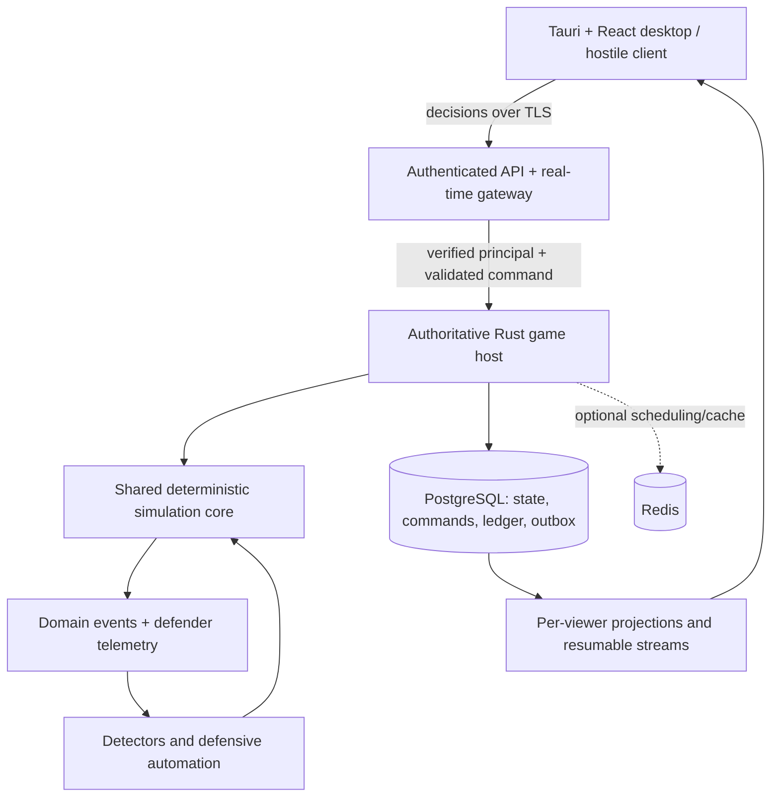

# Technical design

## Authority is a first-class requirement

sudo survive is designed for an authoritative MMO. The shipped vertical slice is
**local training**, not a multiplayer authority. Never promote its SQLite save,
client tick, balance, inventory, attack result, or cached observations into online
truth. A modified desktop must confer no multiplayer advantage.

Start with a modular Rust server and PostgreSQL, not a fleet of services. Redis is
optional for wakeups, cache, and rate limiting; it never becomes the authority for
balances, campaign ownership, or damage. No hosted server, login flow, PostgreSQL
runtime, or player-facing offensive interface is implemented in this increment.

## Implemented boundaries

- `crates/sim`: deterministic state, typed decisions, campaign operations, event
  production, detectors, and viewer projections. No UI, clock, authentication,
  filesystem, or network I/O is needed to run the core.
- `authority.rs`: typed `PlayerId`/`NetworkId`, `WorldIdentity`, `Principal`, scoped
  `Command`/`Decision`, `CampaignController`, `AttackOperation`, and owner/attacker
  projections. Principal is deliberately not deserializable. Its constructor assumes
  a **trusted, already authenticated adapter**; it does not verify authentication.
- `src-tauri`: trusted local adapter, monotonic scheduler, SQLite lifecycle, and
  native window. It supplies the fixed local-training principal, not a player ID
  from the webview. In online mode this scheduler will not advance online worlds.
- `src`: render observable state and submit decisions through `api.ts`. Local UI
  selection and packet animation are non-authoritative. An online transport can
  replace IPC behind that interface without duplicating gameplay rules.
- The loopback development bridge uses the same command/view boundary and engine.
  It is unauthenticated local tooling and must never be exposed as an MMO gateway.
- SQLite is behind the `local-store` feature; the HTTP development bridge is behind
  `dev-bridge`. A server can build the core with `--no-default-features`. The desktop
  selects only `local-store` and needs no development HTTP listener.

The local single mutex serializes commands, ticks, and saves. Raw `World::act` and
`World::view` are crate-private; application adapters use authorized entry points.
Server-side persistence can serialize private World state. It must never send that
serialization as a client response. These boundaries are groundwork, not a claim
that the current executable is safe to expose to hostile online clients.

## Identity, ownership, and models

A `World` currently represents **one network aggregate**, not the entire universe.
It has a network ID, owning player, and local-training/hosted mode. Production IDs
will be server-issued opaque identifiers. Local IDs are reserved and cannot enter
online registries. Host aliases such as WEB-01 and current numeric campaign/event
IDs are scoped by network ID; APIs never resolve them globally. Split immutable
asset identity from a renameable hostname before supporting renames.

A player can own a network and control a campaign in another network simultaneously.
`User`/`Credential` represent a fictional identity such as `deploy`, entirely separate
from real game accounts and sessions. Organizations later replace sole ownership
with explicit membership/role grants; never infer grants from a supplied role name.

Existing models include Server, ServiceSpec, FirewallRule, Network, User, Credential,
Attacker, AttackCampaign, SecurityEvent, Alert, Backup, DetectionRule, and IncidentReport.
Planned online additions: Player/Organization grants, TargetListing, IntelObservation,
AttributionEvidence, scoped CredentialCapability, durable Foothold, CampaignPlan,
ProtectionPolicy, AutomationPolicy, CommandReceipt, and EconomyLedgerEntry.

Catalog services and entry-path timings live in `crates/sim/data/catalog.json`.
Mechanical variation is data-driven where possible; genuinely new mechanics need
code plus causal tests. Pin catalog and simulation versions in online snapshots and
command journals so a rules update cannot silently change replayed outcomes.

## Commands and trust boundary

Current `Command` routes to a specific network and carries either a defender action
or an attacker operation for a specific campaign. Authorization checks the owner or
campaign controller before examining action-specific state. Unauthorized network and
campaign errors are generic. Neither NPC ownership nor another player's campaign
can be claimed by submitting a player ID. The existing local transports still accept
the original defender Action shape and wrap it with a trusted local principal.

Future online command envelopes add protocol version, a unique command ID, optional
expected revision, target/observation handles, and a bounded decision payload. A
claimed actor ID, client timestamp, amount of damage, loot, successful attack flag,
or complete world snapshot is never an authority input.

Admission pipeline:

1. Gateway verifies a real game session, derives Principal, validates size/schema,
   origin where applicable, quotas, and rate limits.
2. Authorize every object and operation, including log searches, subscriptions,
   history, intel shares, and campaign changes. Campaign creation checks training,
   matchmaking, immunity, concurrent slots, costs, and target observation grants.
3. In a transaction, reserve resources/slots and persist a command receipt keyed by
   `(player_id, command_id)`. Duplicate identical requests return the recorded
   receipt; reusing an ID with a different payload is rejected without mutation.
4. Route to the target-network authority. Serialize accepted commands by server
   sequence at tick boundaries. Reject stale destructive configuration edits with
   a conflict; queued attacks re-evaluate current defenses when executed.
5. Commit resulting state, events, receipts, ledger changes, and outbox atomically.
   Publish only committed, recipient-filtered updates. Accepted means queued, not
   successful; operation completion arrives separately.

Clients cannot advance ticks, pause hosted worlds, request arbitrary RNG seeds,
start practice against a victim, change ownership, or assign campaign controllers.
The current library rejects hosted Pause/Practice through the command boundary and
ignores a persisted pause flag for hosted ticks. Creation of a player-controlled
campaign remains trusted harness setup only; there is no online admission endpoint.

## One attack resolver, two decision sources

NPC policy selects `AttackOperation::for_stage`; player-controlled campaigns consume
a queued typed operation. Both run through **the same tick-driven resolver** against
the target network and emit the same telemetry. Queueing does not immediately grant
access, move money, or fabricate logs. One pending operation per campaign is the
initial bound; a queued operation survives serialization and needs no connected UI.
No player operation means no autonomous advancement into the next attack stage.

Current operations: enumerate public service, attempt initial access, execute a
simulated task, establish persistence, discover reachable hosts, attempt lateral
movement, collect records, transfer records. These adapt the existing linear slice;
there are not yet player-selected destination hosts, pace, credentials, objectives,
branching plans, withdrawal/reconnection, or a public target directory.

Current state progression:

Reconnaissance → InitialAccess → Execution → Persistence → Discovery →
LateralMovement → Collection → Exfiltration → Complete / Contained.

Initial access requires a live exposed service, allowed route, and applicable
weakness. Lateral movement requires a known reachable destination, a live service,
enabled identity, valid acquired credential version, and authorization scope.
Exfiltration requires viable access and an allowed egress route. Isolation denies
all host routes. Account disable revokes sessions, persistence can survive it,
rotation invalidates credential reuse, and patching prevents a new web compromise
without evicting an existing foothold. Skill/stealth metadata never overrides these
checks. Successful initial access and later stages generate evidence, not random HP damage.

Before PvP, replace scripted shortcuts: the current fixture seeds an entry credential,
discovery can acquire the deployment credential, and movement tries every discovered
host. Production capabilities must be earned by explicit operations and bound to
actor, target identity, version, privileges, and expiry. Check sufficient source
privilege and destination authorization at each step. Discovery observes only what
a valid route and technique can reveal; it must not enumerate authoritative host
lists into attacker views. The slice filters out unreachable hosts but does not yet
model per-technique discovery permissions.

Durable hosted footholds will live independently of a campaign's connection/report.
They retain technique, required privilege, artifacts, expiry, and revocation state.
Containment of a route does not erase persistence; reconnection rechecks topology,
credentials, expiry, protection, and campaign budget. Online Resume cannot inspect
hidden footholds to return an omniscient “still compromised” error. The local-training
reconnect guard is explicitly mode-specific. Long-term persistence/reconnection is
not implemented by the current one-active-campaign model.

## Events, detection, and fog of war

Game-native action → shared resolver → target SecurityEvent → detector → alert →
manual/automated response → further events and attacker-observable operation result.
Real gateway authentication/audit logs are separate from fictional AUTH_LOGIN_* logs.
Player attacks cannot submit event records or mark detectors as fired.

Current event vocabulary includes authentication, HTTP, processes, files, connections,
firewall blocks, transfer, and response/maintenance actions. Events have scoped ID,
simulation tick, asset, fictional source/destination, account, and message. Detectors
consume telemetry, not private campaign stage or a player/NPC flag. Store controller
identity, authoritative causation, and audit provenance privately, not in defender logs.

| Projection       | Authorized content                                                         | Excluded content                                                            |
| ---------------- | -------------------------------------------------------------------------- | --------------------------------------------------------------------------- |
| Defender         | Own assets/settings, collected telemetry, alerts                           | Private campaign/controller data; opponent identity; undiscovered footholds |
| Attacker         | Its target and acquired observations, queued operation, own access/results | Full target world, balance, firewall, detections, logs, EDR/honeypot flags  |
| Public directory | Eligible pseudonymous listing and bounded public footprint                 | Account/device data and complete topology                                   |
| Server audit     | Full causation and economic accounting                                     | Never delivered as a gameplay stream                                        |

The library now has separate defender and attacker projection types and authorizes
log search before filtering. Hosted projection deliberately omits the current
omniscient training reports and CAMPAIGN_ENDED events; an evidence-based replacement
is required before an online UI. Attacker projection is a minimal harness interface,
not the finished recon/connection-loss experience. UI secrecy is not a substitute
for omitting forbidden data from the serialized response.

Planned IntelObservation includes opaque subject handle, observed attributes,
technique, source/provenance, observed tick, expiry/freshness, and confidence where
justified. Store snapshots of what was observed; never hydrate an old observation
from the target's current configuration. Staleness and capability revocation are
separate: an attacker can remember an old fact without its credential still working.
Transferred intelligence preserves provenance and scope. Honeypots share ordinary
service DTOs. Attribution aggregates evidence and never consults private controller
identity to “guess” the correct player.

WebSocket streams use per-viewer cursors and authorized deltas/snapshots; private
event gaps must not become an oracle. Reconnect authenticates again, rechecks grants,
and resumes from a cursor or resyncs. Client caches are display-only and marked stale.
Visibility, membership, and subscription authorization are rechecked on delivery,
not just at initial subscription.

## Time, concurrency, and asynchronous play

One tick remains one simulated second. Local mode pauses/closes safely; hosted mode
continues independently of client presence and clocks. A target network has one
logical writer. Place its incoming campaigns, defenses, detectors, and automation
in the same authority partition so both players react to one ordered world.

Initial host implementation can schedule aggregates in a single process and use
PostgreSQL transactions with per-network row locks. Later shard by network and use
leases with fencing epochs; every commit verifies the epoch so an old worker cannot
write after failover. Acquire multiple economic/account locks in canonical order.

Tick ordering: accepted control changes → maintenance/economy → due operations →
telemetry/detection → bounded automation → projections/commit. Define ties by
server-assigned sequence, never packet arrival order on separate clients. Automated
responses feed the same command validation and emit events. Limit repeated rules
and action cascades to prevent loops and event storms.

Persist logical tick, RNG state, pending jobs, last applied command, rules version,
and shard epoch. Host restart replays committed work and resumes due work; it does
not trust desktop catch-up requests. Use closed-form idle income only where no
intervening event could change it. Replay active incidents/maintenance in order;
background catch-up is bounded and checkpointed, never skipped to a final outcome.
A service outage pauses offensive consequences and rewards consistently rather
than granting a backlog of invisible attacker turns when service recovers.

The hosted clock, durable scheduler, automation, shard failover, and catch-up remain
future work. The local monotonic scheduler must not be reused as online authority.

## Persistence and economy

**Local:** `001_initial.sql` retains its versioned world snapshot and normalized
recent event/report projections. Snapshot and projections commit atomically in
SQLite/WAL. Autosave every five ticks, after successful commands, and on graceful
quit. Existing format-1 saves default to local ownership and NPC controllers; new
identity/controller/pending-operation fields are additive. Unreadable saves are
surfaced. Window geometry is separate. Nothing is synchronized to an MMO account.

**Planned PostgreSQL model** (design only; no migration or database service yet):

| Table / aggregate                            | Key and purpose                                                                    |
| -------------------------------------------- | ---------------------------------------------------------------------------------- |
| players, organizations, memberships          | Account IDs, roles, revocation; real account metadata separate from public persona |
| networks, world_snapshots                    | Network owner, revision, tick, rules version, state, fencing epoch                 |
| assets / identities / controls               | Network-scoped game entities; initially may live in validated snapshots            |
| campaigns, campaign_jobs, footholds          | Controller/target references, durable plans, budgets, leases, expiry               |
| intel_observations, intel_grants             | Immutable observation payload, subject handle, timestamps, revocable sharing       |
| security_events, alerts, incident_evidence   | Network-scoped ordered telemetry; private provenance in separate fields/tables     |
| command_receipts                             | Unique player + command ID, payload hash, admission/result and commit revision     |
| accounts, ledger_entries, reward_settlements | Immutable balanced postings; unique objective/settlement IDs                       |
| protection_windows, target_pair_history      | Match eligibility, shared loss allowance, repeat-target penalties, reserved slots  |
| outbox, projection_cursors                   | Transactional delivery with idempotent consumers and authorized replay             |

PostgreSQL is the source of truth. In the first online host, use one database
transaction for attacker costs, defender loss caps, rewards, and receipts. Reserves
are spent only once; failed/expired work releases unused reservations. A unique
settlement key prevents replayed completion from awarding duplicate loot. Data
records and cash are separate resources; every currency faucet/sink is explicit.
No eventually consistent cache may decide whether money or immunity exists.

After sharding across databases, introduce a specified reservation/settlement
protocol with idempotent messages and reconciliation before cross-shard transfers;
do not quietly replace atomic accounting with two unrelated writes. Online event
retention and analytics can be tiered; keep incident evidence and economic audits
for their declared retention periods. Local caps (600 events, 20 reports) are UI
budgets, not a production durability policy.

## Real application security and player protection

The gateway must authenticate and authorize every decision and read; validate
WebSocket origin/session lifecycle and bound messages, reconnect rates, and
subscriptions. This follows the object-level authorization and message-handling
concerns in the [OWASP API authorization guidance](https://api-security.owasp.org/editions/2023/en/0xa1-broken-object-level-authorization/)
and [WebSocket guidance](https://cheatsheetseries.owasp.org/cheatsheets/WebSocket_Security_Cheat_Sheet.html).

No P2P connections. Simulated network code does no DNS resolution, sockets, shell
execution, or filesystem targeting. Gateway transport inevitably handles real IPs;
any necessary operational/abuse logs are access-controlled, minimized, retained
separately, and never appear in gameplay, attribution, markets, or client exports.
Collect no real hostname, LAN topology, filesystem contents, or traffic for game
mechanics. Simulated identifiers cannot become URLs or outbound server requests.

Online client tokens stay out of localStorage and game saves; use a reviewed native
credential-store/session integration. Harden CSP/IPC scopes, transport security,
session revocation, secrets management, migrations, and backups before deployment.
The existing local bridge and save format are not account-authentication mechanisms.

Anti-griefing is admission **and execution** policy: enforce eligibility, shields,
resource/loss budgets, recovery reserves, campaign limits, cooldowns, and repeat-target
rules transactionally, including reconnects and queued jobs. Apply limits across
all attackers, organizations, and linked abuse cases. Marketplace/insurance/bounty
settlements must not bypass those controls. Defenders must have affordable recovery
and automated away protection before asynchronous PvP is enabled.

## Verification and rollout

Current tests must preserve the local loop and add: forged owner/network rejection,
unauthorized campaign control/read rejection, invalid stage/duplicate queue rejection,
no mutation on rejected commands, NPC/player event equivalence, independent defender
containment of player-controlled access, isolation of unseen hosts, serialized queued
operation continuity, legacy-save defaults, and hosted pause/training restrictions.
Compile/test the core without local storage/HTTP features. Keep existing SQLite,
causal movement, restoration, TypeScript, browser playthrough, and native checks.

Next steps, in order:

1. Extend the two-principal in-process harness into a recon training scenario with
   explicit destinations/capabilities, stale observations, selective operations,
   persistent footholds, and evidence-only postmortems. No online client yet.
2. Add authenticated Rust host + PostgreSQL transactional command log, ledger,
   authoritative ticks, and separate viewer streams. Test two clients: attack emits
   defender AUTH_LOGIN_FAILED; detection fires; isolation breaks attacker access.
3. Before private asynchronous PvP, implement the protective policies and away
   automation in GAME_DESIGN.md. Test disconnects, replay/duplicate/out-of-order
   requests, concurrent spends, cross-tenant reads, stale credential/intel use,
   shield races, collusion, host crash, outbox redelivery, and recovery at zero funds.
4. Load-test idle/active aggregate scheduling and bounded telemetry; only then add
   organization-scale play, marketplaces, bounties, and richer objective mechanics.

No production auth, PostgreSQL schema, deployment, or full MMO is part of this
increment. The local first playable remains runnable while those contracts evolve.

## References

- [Tauri command interface](https://v2.tauri.app/develop/calling-rust/)
- [Tauri platform prerequisites](https://v2.tauri.app/start/prerequisites/)
- [PostgreSQL explicit locking](https://www.postgresql.org/docs/17/explicit-locking.html)
